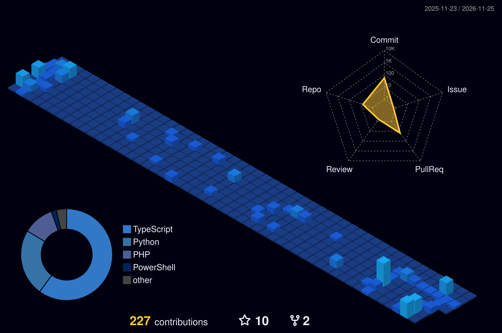

# Hi, I'm Gustavo 👋

**Full-stack engineer, frontend-focused** — based in São Paulo, Brazil 🇧🇷. I build fast, polished web and mobile products with **TypeScript, React and Next.js**, and I'm comfortable on the backend with **PHP/Laravel** and **Python**.

For 1+ year I have worked on **healthcare software** — telemedicine, patient triage and camera-based vital-signs measurement — where reliability, accessibility and data privacy matter.

🌍 **Open to remote roles (US/EU time zones).**

## Featured projects

| Project | What it is | Stack |
|---|---|---|
| [**WorkoutPro**](https://github.com/gusata/WorkoutPro) | Local-first strength-training tracker for Android and web, with optional Supabase sync (conflict handling, RLS) and a Wear OS companion app. Unit, e2e and visual tests. | Next.js · React · TypeScript · Dexie · Supabase · Capacitor · Kotlin |
| [**Edge Ghosty**](https://github.com/gusata/Ghosty) | Windows edge-docked quick panel with media/volume, focus timer, launcher, clipboard shelf and optional GitHub/Vercel/Google panels. Signed auto-updates and a CI release pipeline. | Tauri 2 · Rust · TypeScript |
| [**Necromante**](https://github.com/gusata/necromante) | Pixel-art roguelite defense game for mobile with a deterministic, unit-tested simulation and a balance simulator. | TypeScript · Phaser 3 · Vite · Capacitor |
| [**Sinal**](https://github.com/gusata/sinal) | Narrative idle game with offline progress, prestige and a CI pipeline that builds an Android APK. | TypeScript · Vite · Capacitor · GitHub Actions |
| [**DUALITY portfolio**](https://github.com/gusata/Portifolio) · [gusata.dev.br](https://gusata.dev.br) | Bilingual (PT/EN) portfolio built as an exhibition with two worlds — Developer and Photographer. | Next.js 16 · React 19 · Framer Motion · Tailwind CSS |

## Tech stack

## What I care about

- **Frontend quality:** accessible, fast, well-tested interfaces (unit, end-to-end and visual-regression tests).
- **Reliable data flows:** local-first apps, safe sync and conflict handling, row-level security.
- **Shipping:** CI/CD, signed releases and clear documentation.

## Get in touch

 

<a href="https://github.com/gusata">
  <picture>
    
  </picture>
</a>
